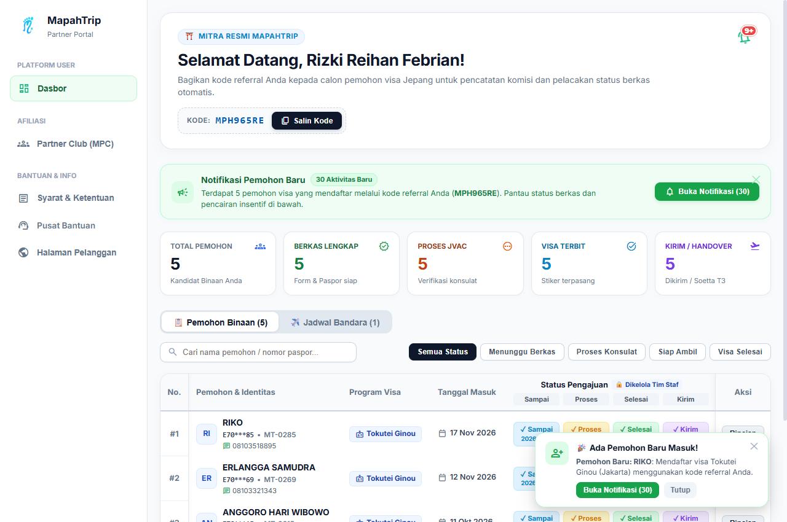

# 📖 Panduan Resmi Mitra Affiliate MapahTrip
**Spesialis Jasa Pengurusan Visa Jepang & e-Visa / Waiver**

Buku panduan ini disusun khusus untuk mitra affiliate MapahTrip, mulai dari pendaftaran akun baru, pengambilan dan penyebaran kode referral, pemantauan status berkas pemohon binaan, hingga mekanisme pencairan komisi ke rekening bank Anda.

---

## 🎯 1. Keuntungan Menjadi Mitra Affiliate MapahTrip

Sebagai mitra resmi MapahTrip, Anda mendapatkan:
1. **Komisi Menarik & Pasti:**
   - **Rp 50.000 / paspor** untuk kategori Visa Turis / Kunjungan / e-Visa Waiver.
   - **Hingga Rp 150.000 / paspor** untuk program khusus (Tokutei Ginou / Bekerja / Visa Bisnis).
2. **Dashboard Mandiri Realtime:** Pantau langsung berapa banyak calon pemohon yang mendaftar menggunakan kode Anda, status kelengkapan berkas fisik, proses di JVAC/Kedutaan, hingga visa terbit.
3. **Pencairan Terbuka & Transparan:** Komisi otomatis terhitung saat biaya visa pemohon telah lunas diverifikasi oleh tim pusat MapahTrip.
4. **Mapah Partner Club (MPC):** Program reward berjenjang (Bronze, Silver, Gold, Platinum) dengan bonus tambahan bagi mitra aktif.

---

## 📝 2. Tahap Pendaftaran Akun Mitra Baru

Untuk bergabung menjadi mitra affiliate, ikuti langkah berikut:

1. Buka halaman portal mitra melalui tautan: `https://mapahtrip.id/#affiliate`.
2. Pada form masuk, klik tombol biru **"Daftar Akun Baru"**.
3. Lengkapi formulir pendaftaran mitra:
   - **Nama Lengkap:** Masukkan nama asli sesuai identitas KTP.
   - **Nomor WhatsApp:** Gunakan nomor WhatsApp aktif (digunakan untuk notifikasi pendaftaran pemohon binaan dan konfirmasi transfer komisi).
   - **Alamat Email:** Email aktif untuk keperluan login ke portal.
   - **Kata Sandi (Password):** Buat kata sandi minimal 6 karakter yang aman.
   - **Data Rekening Bank Pencairan:**
     * Nama Bank (BCA, Mandiri, BRI, BNI, BTN, BSI, dll).
     * Nomor Rekening Bank.
     * Nama Pemilik Rekening (pastikan sama dengan nama Anda agar proses transfer komisi tidak tertolak).
4. Klik tombol **"Daftar Sebagai Mitra"**. Akun Anda akan langsung aktif dan Anda akan mendapatkan **Kode Referral Resmi Unik** (misal: `MPH965RE`).

*(Tampilan Formulir Pendaftaran Mitra Resmi MapahTrip)*

---

## 🔑 3. Login & Akses Portal Mitra

Setiap kali ingin mengecek performa atau menyalin kode referral:
1. Kunjungi `https://mapahtrip.id/#affiliate`.
2. Masukkan **Alamat Email** atau **Kode Referral** Anda serta **Kata Sandi**.
3. Klik tombol **"Masuk ke Portal Mitra ➔"**.
4. Jika lupa kata sandi, klik tautan *"Lupa kata sandi?"* untuk terhubung langsung ke WhatsApp Helpdesk Admin MapahTrip di `0814-0173-5648`.

---

## 🚀 4. Cara Mengambil & Membagikan Kode Referral

Di bagian paling atas dashboard mitra, Anda akan melihat kartu selamat datang yang memuat kode referral resmi Anda.

*(Tampilan Dashboard Utama Mitra Affiliate MapahTrip)*

### Langkah Membagikan Rekomendasi:
1. Klik tombol **"Salin Kode"** pada kotak kode referral Anda (contoh: `MPH965RE`).
2. Bagikan kode tersebut kepada rekan, keluarga, siswa LPK, atau klien travel yang membutuhkan jasa pengurusan visa Jepang.
3. **Penerapan oleh Pemohon:**
   - Arahkan pemohon membuka `https://mapahtrip.id`.
   - Saat pemohon memilih paket visa dan menekan tombol pendaftaran, akan muncul pertanyaan:
     > *"Apakah kamu punya kode referral mitra?"*
   - Pemohon memilih opsi **"Ya, Punya Kode"** dan memasukkan kode Anda (contoh: `MPH965RE`).
   - Begitu formulir dikirim, pemohon tersebut otomatis tercatat sebagai **Kandidat Binaan Anda** secara permanen di sistem MapahTrip!

---

## 📊 5. Memahami Fungsi Menu & Indikator Dashboard

Dashboard mitra dirancang agar Anda bisa mengawasi seluruh tahapan berkas kandidat binaan Anda tanpa perlu bertanya manual ke admin:

### A. Kartu Ringkasan Statistik
- **Total Pemohon:** Total akumulasi orang yang pernah mendaftar memakai kode referral Anda.
- **Berkas Lengkap:** Jumlah pemohon yang paspor fisik dan dokumen persyaratannya sudah tiba di kantor staf PIC MapahTrip.
- **Proses JVAC:** Jumlah pemohon yang berkasnya sedang antre/diverifikasi oleh pihak Konsulat Jenderal Jepang / JVAC VFS Global.
- **Visa Terbit:** Jumlah pengajuan yang telah berhasil disetujui dan visanya selesai ditempel di paspor.

### B. Daftar Pemohon Binaan
Tabel interaktif yang menampilkan:
- **Nama Pemohon:** Ditampilkan nama depan dengan sensor privasi (contoh: `BIMA H*****`).
- **Program Visa:** Menjelaskan jenis visa (Tokutei Ginou, Turis Single Entry, Multiple Entry, atau e-Visa Waiver).
- **Status Berkas:** Menunjukkan posisi berkas secara live (`Berkas Tiba` ➔ `Proses JVAC` ➔ `Visa Terbit` ➔ `Dikirim`).
- **Status Komisi:**
  * `Menunggu Pembayaran Pemohon`: Pemohon belum melunasi biaya visa ke kantor pusat.
  * `Siap Cair`: Biaya visa pemohon telah lunas, menunggu jadwal transfer komisi.
  * `Sudah Ditransfer`: Komisi telah dikirimkan ke rekening bank Anda.

### C. Program Mapah Partner Club (MPC)
Tingkatkan terus jumlah pengajuan visa melalui kode Anda untuk membuka jenjang kemitraan yang lebih tinggi:
- **Bronze Partner:** 1 - 10 pemohon / bulan.
- **Silver Partner:** 11 - 25 pemohon / bulan (+ Bonus insentif).
- **Gold Partner:** 26 - 50 pemohon / bulan (+ Prioritas screening).
- **Platinum Club:** > 50 pemohon / bulan (+ Custom branding & sharing profit eksklusif).

---

## 💰 6. Prosedur & Jadwal Pencairan Komisi

1. **Kapan Komisi Berhak Cair?**
   Komisi berhak cair setelah berkas fisik pemohon dipastikan tiba di kantor PIC MapahTrip dan pemohon telah menyelesaikan pembayaran resmi ke rekening PT Tokyo Asia Connection.
2. **Metode Pembayaran Komisi:**
   Tim Finance MapahTrip akan mentransfer komisi langsung ke nomor rekening yang Anda cantumkan pada saat pendaftaran.
3. **Bukti Transfer:**
   Setiap pencairan komisi akan disertai bukti transfer resmi dari Bank BTN/BCA perusahaan yang dikirimkan via WhatsApp ke nomor Anda.
4. **Perubahan Rekening Bank:**
   Jika Anda ingin mengganti nomor rekening penerima komisi, hubungi Admin Helpdesk melalui tombol WhatsApp di pojok kiri bawah portal mitra.

---

> 💡 **Pusat Bantuan Resmi Mitra:**
> Jika Anda memiliki pertanyaan seputar berkas pemohon atau kendala komisi, hubungi WhatsApp Hotline Mitra di **0814-0173-5648**.
