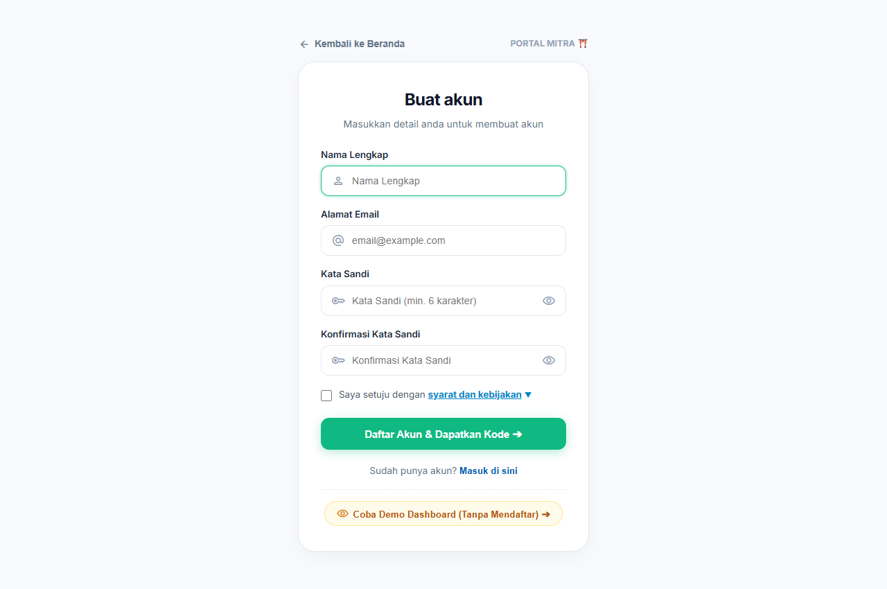

# 📖 Panduan Praktis Mitra Affiliate MapahTrip
**Alur Lengkap: Dari Daftar, Isi Bank/E-Wallet, Bawa Pemohon, Hingga Komisi Ditransfer**

Panduan ini menjelaskan secara ringkas, jelas, dan padat tahapan menjadi mitra affiliate MapahTrip hingga menerima transfer komisi.

---

## 🚀 6 Tahap Alur Mitra Affiliate (Ringkas & Detail)

```
[1. Daftar Akun Baru]
          │
          ▼
[2. Dapat Kode Referral Unik (misal: MPH965RE)]
          │
          ▼
[3. Lengkapi Biodata & Rekening Bank / E-Wallet (DANA/OVO/GoPay/BCA dll)]
          │
          ▼
[4. Bagikan Kode ➔ Bawa Pemohon Visa (Pemohon input kode saat daftar)]
          │
          ▼
[5. Staf & Owner Proses Berkas di Konsulat sampai Visa Selesai & Lunas]
          │
          ▼
[6. Owner Transfer Komisi Rp 100.000/orang ke Bank/E-Wallet Mitra + Bukti TF]
```

---

## 📝 LANGKAH 1: Pendaftaran Akun Mitra Baru
1. Buka tautan: `https://mapahtrip.id/#affiliate`.
2. Klik tombol biru **"Daftar Akun Baru"**.
3. Masukkan data dasar:
   - **Nama Lengkap:** Nama asli Anda sesuai identitas.
   - **Nomor WhatsApp:** Nomor WhatsApp aktif untuk notifikasi calon pemohon dan pemberitahuan transfer komisi.
   - **Alamat Email:** Digunakan untuk masuk (login) ke portal mitra.
   - **Kata Sandi (Password):** Minimal 6 karakter.
4. Klik **"Daftar Sebagai Mitra ➔"**.



---

## 🔑 LANGKAH 2: Mendapatkan Kode Referral Unik
- Setelah berhasil mendaftar dan masuk ke dasbor, sistem secara otomatis menerbitkan **Kode Referral Resmi Anda** (contoh: `MPH965RE`).
- Kode ini akan selalu muncul di bagian atas dasbor portal mitra lengkap dengan tombol **"Salin Kode"**.


---

## 💳 LANGKAH 3: Isi Biodata & Rekening Bank / E-Wallet Pencairan
Sebelum membagikan kode referral, mitra **wajib melengkapi data pencairan** agar sistem siap mentransfer komisi:

1. Di Dasbor Mitra, klik tombol **"Profil / Pengaturan Rekening"**.
2. **Lengkapi Biodata:**
   - Kategori Mitra: Pilih *Umum*, *LPK Jepang*, *Agen Tour & Travel*, *Alumni Pekerja Tokutei Ginou*, atau *Konsultan Visa*.
   - Asal Provinsi / Kota.
3. **Pilih Jenis Pencairan (Bisa Bank atau E-Wallet):**
   - **Pilihan 1 - Rekening Bank:** Pilih nama bank (BCA, Bank Mandiri, BRI, BNI, Bank BTN, BSI, atau Bank Digital SeaBank/Jago). Masukkan **Nomor Rekening** dan **Nama Pemilik Rekening**.
   - **Pilihan 2 - E-Wallet:** Pilih aplikasi (DANA, OVO, GoPay, ShopeePay, LinkAja, atau AstraPay). Masukkan **Nomor HP Akun E-Wallet** dan **Nama Akun E-Wallet**.
4. Klik **"Simpan Rekening Pencairan"**.
   > 📌 *Data rekening/e-wallet inilah yang akan digunakan oleh Owner MapahTrip untuk mentransfer uang komisi Anda saat pengurusan visa selesai.*

---

## 📢 LANGKAH 4: Membagikan Kode & Membawa Pemohon (Referral)
1. Bagikan kode referral Anda (misal `MPH965RE`) kepada rekan, keluarga, siswa LPK, atau klien Anda yang ingin membuat visa Jepang.
2. Saat pemohon membuka `mapahtrip.id` dan memilih jenis visa, di formulir pendaftaran pemohon memilih:
   > **"Ya, Punya Kode Referral Mitra"** ➔ masukkan kode Anda (contoh: `MPH965RE`).
3. Begitu pemohon menekan tombol kirim formulir:
   - Nama pemohon langsung otomatis muncul di tabel **"Kandidat Binaan Anda"** pada dasbor portal mitra Anda.
   - Anda menerima notifikasi di dasbor dan WhatsApp bahwa ada pemohon baru yang Anda bawa.

---

## ⚙️ LANGKAH 5: Proses Berkas Fisik & Pembayaran Lunas
- Pemohon mengirimkan dokumen paspor fisik ke kantor Staf PIC Konsulat (Jakarta, Surabaya, Medan, Makassar, Denpasar).
- Staf PIC konfirmasi berkas sampai ➔ Owner mengirim invoice penagihan resmi ke pemohon.
- Setelah pemohon melunasi pembayaran ke Bank BTN PT Tokyo Asia Connection, berkas diserahkan staf ke loket Kedutaan/JVAC hingga **Visa Terbit (Status Selesai)**.

---

## 💰 LANGKAH 6: Transfer Komisi oleh Owner ke Bank/E-Wallet Mitra
1. **Besaran Komisi:**
   - **Rp 100.000 per orang/pemohon** (kategori Turis, Kunjungan Keluarga, Bisnis).
   - **Hingga Rp 150.000 per orang** untuk program kerja Tokutei Ginou.
   - Komisi dihitung per kepala: jika Anda membawa 5 orang, Anda mendapatkan **Rp 500.000**!
2. **Pencairan Otomatis:**
   - Karena visa pemohon telah selesai dan lunas, data pemohon langsung masuk ke antrean pencairan Owner.
   - Owner langsung mentransfer komisi ke nomor **Rekening Bank atau E-Wallet** yang sudah Anda isi di Langkah 3 tadi.
3. **Konfirmasi & Bukti Transfer:**
   - Owner mengunggah struk transfer bank.
   - Anda otomatis menerima pesan WhatsApp resmi berisi rincian transfer (nama pemohon, nominal Rp 100.000/orang, nomor referensi TRX, dan foto struk bukti transfer).
   - Status di dasbor portal mitra Anda berubah dari *Menunggu Pembayaran* menjadi **"Berhasil Ditransfer"**.
