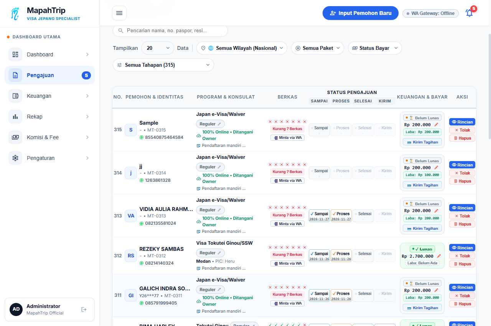
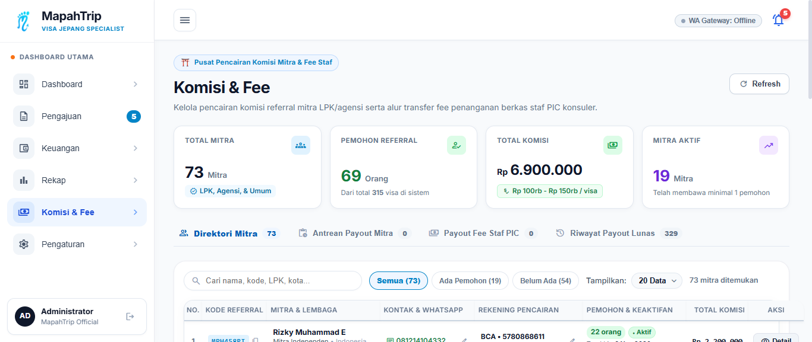
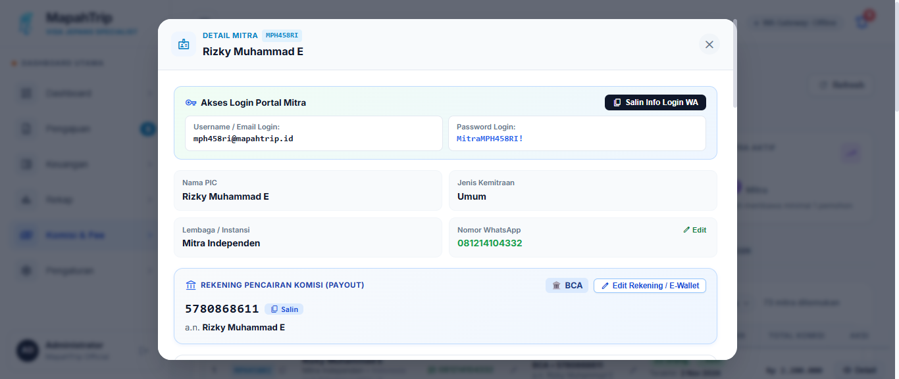
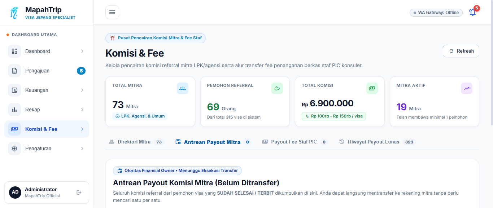
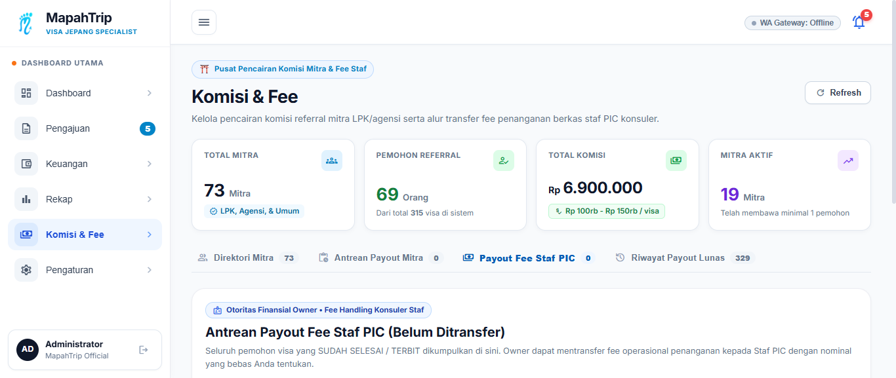
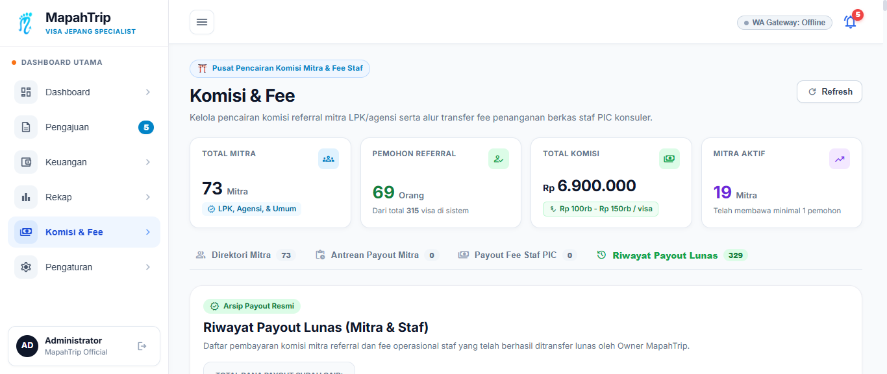
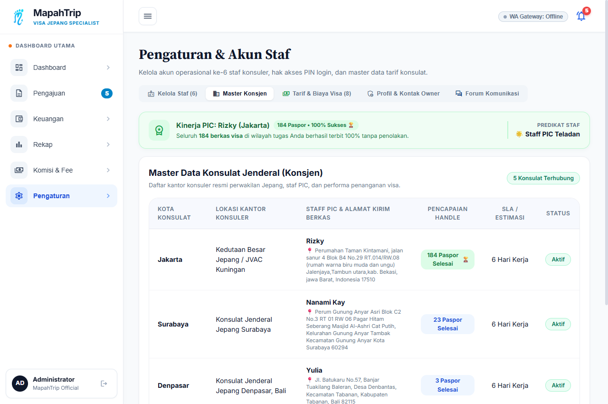

# 👑 Panduan Eksekutif Owner & Super Admin
**MapahTrip — Kendali Bisnis, Keuangan, & Otorisasi Operasional**

Buku panduan ini merupakan acuan operasional dan finansial resmi bagi Owner / Manajemen Puncak MapahTrip. Panduan ini mencakup pengelolaan arus kas (omset, modal loket konsulat, komisi mitra, fee staf, laba bersih), siklus penagihan invoice ke pemohon, otorisasi status pembayaran (buka kunci proses staf), hingga **pengelolaan komisi mitra & fee staf PIC secara terperinci (Direktori Mitra, Antrean Payout Mitra, Payout Fee Staf PIC, dan Riwayat Payout Lunas)**.

---

## 🏛️ 1. Otoritas & Peran Super Admin

Sebagai Super Admin, Anda memegang kendali penuh atas:
1. **Keuangan Realtime:** Memantau pendapatan kotor (omset), beban pengeluaran loket JVAC/Kedutaan, kewajiban komisi rekanan, dan laba bersih perusahaan.
2. **Otorisasi Pembayaran (Billing Gateway):** Menjadi satu-satunya pihak yang berhak menyatakan bahwa pembayaran biaya visa telah **"Lunas"** ke rekening PT Tokyo Asia Connection.
3. **Pengendali Kunci Operasional:** Status *Lunas* dari Owner adalah kunci pengaman yang membuka izin Staf PIC untuk memproses berkas ke loket JVAC.
4. **Pusat Pencairan Komisi & Fee:** Mengelola antrean transfer komisi mitra (Rp 100.000 / orang) dan fee staf PIC (Rp 50.000 / paspor) secara transparan.

---

## 📈 2. Bedah Tampilan Dashboard Eksekutif Keuangan

Berikut adalah tampilan utama Dashboard Finansial Owner:

### 🔍 Penjelasan Rinci Setiap Bagian pada Gambar Dashboard Owner:

#### 1. Lima (5) Pilar Metrik Finansial Utama:
- **Total Pemasukan (Omset): `Rp 218.400.000`**
  * Seluruh akumulasi dana yang ditagihkan dan dibayarkan oleh pemohon visa dari semua program.
- **Biaya Konsulat & JVAC: `Rp 140.700.000`**
  * Estimasi pengeluaran wajib yang harus disetorkan ke loket VFS Global / Konsulat Jenderal Jepang untuk penerbitan stiker visa resmi.
- **Total Komisi Mitra: `Rp 21.000.000`**
  * Akumulasi kewajiban komisi yang harus dibayarkan ke mitra affiliate (**Rp 100.000 per orang/visa**, hingga Rp 150.000 untuk program khusus).
- **Total Fee Staf PIC: `Rp 10.500.000`**
  * Akumulasi kewajiban fee operasional untuk staf lapangan PIC konsulat (**Rp 50.000 per paspor selesai**).
- **Laba Bersih MapahTrip: `Rp 46.200.000`**
  * Margin laba murni perusahaan setelah dikurangi seluruh biaya pihak ketiga:
    $$\text{Laba Bersih} = \text{Omset} - (\text{Biaya Konsulat} + \text{Komisi Mitra} + \text{Fee Staf})$$

#### 2. Distribusi Sebaran 5 Wilayah Konsulat:
- Menampilkan grafik / tabulasi pembagian volume pengajuan di seluruh yurisdiksi Indonesia:
  * **Konsjen Jakarta (KBRI):** 180 pemohon (volume terbesar).
  * **Konsjen Surabaya:** 15 pemohon.
  * **Konsjen Medan:** 5 pemohon.
  * **Konsjen Makassar:** 5 pemohon.
  * **Konsjen Bali / Denpasar:** 5 pemohon.

---

## 💳 3. Bedah Tampilan Menu Pengajuan & Prosedur Penagihan

Menu Pengajuan adalah tempat eksekusi penagihan invoice resmi dan validasi mutasi pembayaran:

### 🔍 Alur Penagihan & Otorisasi Pembayaran (Billing Cycle):
1. **Penerimaan Notifikasi Berkas Sampai:** Begitu Staf PIC mengklik tombol *"Sampai"*, Owner menerima notifikasi WA bahwa berkas fisik MT-xxxx telah tiba di kantor PIC.
2. **Tombol Hijau "Kirim Tagihan":**
   - Klik tombol ini untuk membuka chat WhatsApp resmi ke pemohon dengan format invoice otomatis:
     * Rincian ID Pengajuan & Nama Pemohon
     * Paket Program & Tambahan (Reguler / Premium)
     * Total Biaya
     * **Nomor Rekening Resmi Pembayaran:**
       > **Bank BTN**  
       > No. Rekening: **1401-50-008080-6**  
       > Atas Nama: **PT Tokyo Asia Connection**
3. **Tombol Status Pembayaran ("Belum Lunas" ➔ "Lunas"):**
   - Setelah pemohon mengirim bukti transfer dan Owner mengecek mutasi rekening Bank BTN, Owner mengklik tombol status bayar dan memilih **"Lunas"**.
   - ⚡ **Dampak Instan:** Status berubah menjadi hijau (*LUNAS - Siap JVAC*), dan sistem **membuka gembok tombol "Proses" di portal Staf PIC**, memberi lampu hijau bagi staf untuk memproses berkas ke loket JVAC.

---

## 💼 4. Bedah Lengkap Menu "Komisi & Fee" (Pusat Pencairan Mitra & Staf)

Menu **Komisi & Fee** adalah modul khusus Super Admin untuk mengelola seluruh mitra affiliate, menstransfer komisi referral (**Rp 100.000 / orang**), mentransfer fee operasional staf PIC (**Rp 50.000 / paspor**), serta mengarsipkan bukti transfer bank.

Menu ini terbagi menjadi **Empat (4) Tab Utama**:

---

### 📂 TAB 1: Direktori Mitra

Tab ini menampilkan seluruh database mitra affiliate (LPK, Agensi, Agen Travel, & Mitra Mandiri) yang terdaftar di sistem MapahTrip.

#### 🔍 Penjelasan Bagian pada Tab Direktori Mitra:

1. **Empat (4) Card Metrik Ringkasan Mitra:**
   - **TOTAL MITRA (74 Mitra):** Jumlah seluruh akun mitra yang terdaftar di sistem.
   - **PEMOHON REFERRAL (69 Orang):** Total calon pemohon visa yang masuk menggunakan kode referral mitra.
   - **TOTAL KOMISI (Rp 6.900.000):** Akumulasi total komisi yang telah dihasilkan oleh mitra binaan (skema resmi: **Rp 100.000 - Rp 150.000 / visa**).
   - **MITRA AKTIF (19 Mitra):** Jumlah mitra yang telah berhasil membawa minimal 1 orang pemohon visa.

2. **Filter & Pencarian:**
   - **Kotak Pencarian:** Cari berdasarkan nama mitra, kode referral (misal: `MPH458RI`), nama lembaga/LPK, atau kota asal.
   - **Filter Kategori Cepat:**
     * `Semua (74)`: Menampilkan seluruh mitra.
     * `Ada Pemohon (19)`: Menyaring mitra yang aktif membawa pemohon.
     * `Belum Ada (55)`: Menyaring mitra baru yang belum membawa pemohon.
   - **Tampilkan Data:** Pilihan pagination (10, 20, 50, atau 100 data per halaman).

3. **Kolom Tabel Direktori Mitra:**
   - **KODE REFERRAL:** Kode unik mitra (misal `MPH458RI`) dengan tombol salin (copy) sekali klik.
   - **MITRA & LEMBAGA:** Nama mitra, status kemitraan (misal: *Mitra Independen* atau *LPK Hibiki*), dan email login mitra.
   - **KONTAK & WHATSAPP:** Nomor WhatsApp mitra dengan ikon pensil untuk mengedit/memperbarui nomor WA secara langsung.
   - **REKENING PENCAIRAN:** Nama Bank (BCA, BSI, Mandiri, dll), Nomor Rekening, dan Nama Pemilik Rekening, lengkap dengan tombol pensil untuk mengedit/memperbarui nomor rekening mitra jika ada kesalahan.
   - **PEMOHON & KEAKTIFAN:**
     * Menampilkan jumlah pemohon yang dibawa (misal: `22 orang`).
     * Status keaktifan: `Aktif` (hijau, membawa pemohon dalam 30 hari terakhir) atau `Mulai Pasif` (kuning, 1-3 bulan belum membawa pemohon).
     * Waktu terakhir membawa pemohon (misal: *2 Nov 2026 / 3 minggu lalu*).
   - **TOTAL KOMISI:** Akumulasi komisi yang berhak diterima mitra:
     $$\text{Total Komisi} = \text{Jumlah Pemohon} \times \text{Rp 100.000}$$
     *(Contoh: 22 orang = Rp 2.200.000, 9 orang = Rp 900.000, 6 orang = Rp 600.000).*
   - **TOMBOL AKSI "DETAIL":** Membuka jendela pop-up lengkap profil mitra.

#### 🔍 Tampilan Pop-up "Detail Profil Mitra & Rekap Payout":

Pada jendela pop-up ini, Owner dapat:
- Melihat ringkasan total binaan, komisi selesai ditransfer, dan antrean yang belum cair.
- Mengubah nama bank, nomor rekening, dan nama pemilik rekening secara instan jika mitra mengganti rekening.
- Mengubah nomor WhatsApp mitra secara instan.
- Melihat daftar seluruh pemohon yang didaftarkan oleh mitra tersebut beserta tanggal dan status pengajuannya.

---

### ⏳ TAB 2: Antrean Payout Mitra

Tab ini adalah tempat kerja Owner untuk mengeksekusi transfer komisi kepada mitra yang berhak menerima pembayaran.

#### 🔍 Mekanisme Kerja Antrean Payout Mitra:
1. **Kapan Pemohon Masuk ke Antrean Ini?**
   Pemohon binaan mitra otomatis masuk ke antrean ini jika:
   - Status pengajuan visa pemohon telah **"Selesai"** (stiker visa terbit).
   - Biaya jasa visa telah dibayar **Lunas** oleh pemohon ke rekening MapahTrip.
   - Komisi referral mitra (**Rp 100.000 / orang**) belum ditransfer oleh Owner.
   - ⚠️ **Khusus Visa Waiver (Rp 200.000):** Tidak berlaku kode referral dan tidak menghasilkan komisi mitra karena biaya pengurusan sudah flat sangat terjangkau. Sistem otomatis menonaktifkan kode referral untuk program Waiver.
2. **Alur Pelaksanaan Transfer oleh Owner:**
   - **Langkah 1:** Buka baris antrean pemohon, lalu klik tombol **"Bayar Payout / Transfer"**.
   - **Langkah 2:** Muncul modal transfer yang menampilkan data lengkap rekening mitra:
     * Nama Bank & Nomor Rekening mitra (tersedia tombol **"Salin Rekening"** agar Owner tidak perlu mengetik ulang saat membuka m-Banking).
     * Nominal transfer: Terisi otomatis **Rp 100.000** (atau Rp 150.000 sesuai tipe program).
     * Nomor Referensi: Terisi otomatis dengan kode transaksi unik (misal: `TRX-PAYOUT-20261128-8921`).
   - **Langkah 3:** Owner melakukan transfer dana melalui m-Banking / Internet Banking bank ke rekening mitra.
   - **Langkah 4:** Simpan struk/tangkapan layar bukti transfer, lalu unggah pada kotak **"Unggah Bukti Transfer"**. Sistem akan otomatis mengompres gambar di bawah 100KB dan menyimpannya di Cloud Storage.
   - **Langkah 5:** Klik tombol **"Konfirmasi Payout Lunas"**.
3. **Notifikasi Otomatis WhatsApp ke Mitra:**
   Seketika tombol konfirmasi ditekan, sistem WA Gateway MapahTrip akan otomatis mengirimkan pesan resmi ke WhatsApp mitra:
   > *"Halo Kak [Nama Mitra] 👋, kabar gembira! Komisi referral kemitraan MapahTrip Anda sebesar Rp 100.000 untuk pemohon visa [Nama Pemohon] telah berhasil ditransfer oleh Owner ke rekening [Nama Bank] [No. Rekening] a.n [Nama Pemilik]. No. Ref: TRX-PAYOUT-xxxx. Terima kasih atas kerja samanya!"*

---

### 👔 TAB 3: Payout Fee Staf PIC

Tab ini khusus untuk mengelola pencairan fee penanganan operasional bagi Staf PIC konsulat (Jakarta, Surabaya, Medan, Makassar, Denpasar).

#### 🔍 Mekanisme Kerja Payout Fee Staf PIC:
1. **Hak Fee Staf:** Setiap paspor fisik yang selesai diproses oleh staf PIC di loket konsulat memberikan hak fee sebesar **Rp 50.000 / paspor**.
2. **Pengecualian Program Waiver / e-Visa:** Program Waiver & e-Visa **TIDAK** masuk ke antrean fee staf PIC karena ditangani 100% secara digital oleh tim pusat/Owner tanpa penyerahan paspor fisik ke loket konsulat.
3. **Filter Berdasarkan Staf:** Owner dapat memfilter antrean per staf (misal: *Rizki / Ulla Jakarta, PIC Surabaya, PIC Medan, dll*).
4. **Alur Transfer Fee Staf:**
   - Owner mengklik tombol proses fee staf.
   - Muncul modal transfer memuat nominal (default Rp 50.000 per paspor, dapat disesuaikan jika ada bonus khusus).
   - Salin nomor rekening staf, transfer via m-Banking, unggah struk bukti transfer, lalu klik **"Konfirmasi Transfer Fee"**.
   - Staf menerima notifikasi WA bahwa fee penanganan paspor pemohon tersebut telah lunas ditransfer.

---

### 📜 TAB 4: Riwayat Payout Lunas

Tab ini merupakan arsip buku besar (ledger) seluruh pembayaran komisi mitra dan fee staf yang telah berhasil ditransfer di masa lalu.

#### 🔍 Fitur-Fitur pada Tab Riwayat Payout Lunas:
1. **Filter Kategori Payout:**
   - `Semua Payout`: Menampilkan seluruh transaksi yang telah lunas (329+ transaksi).
   - `Khusus Mitra`: Menyaring hanya pembayaran komisi referral mitra (Rp 100.000 / orang).
   - `Khusus Staf PIC`: Menyaring hanya pembayaran fee staf lapangan (Rp 50.000 / paspor).
2. **Pencarian Riwayat Cepat:**
   - Cari berdasarkan nama pemohon, nomor paspor, nama mitra, nama staf, nomor referensi transaksi (`TRX-PAYOUT-...`), atau tanggal transfer.
3. **Pemeriksaan & Pengelolaan Bukti Transfer (Audit):**
   - Di setiap baris, terdapat tombol **"Lihat Bukti Transfer"**.
   - Klik untuk membuka pratinjau gambar struk mutasi bank resolusi penuh.
   - **Fitur Khusus Owner (Koreksi Bukti):** Jika sebelumnya salah mengunggah struk transfer, Owner dapat mengklik tombol **"Ganti Foto Bukti"** untuk mengoreksi struk baru, atau **"Hapus Foto"** jika diperlukan.

---

## ⚙️ 5. Bedah Tampilan Menu Pengaturan Master & Tarif

Menu Pengaturan digunakan untuk mengelola data operasional kantor dan struktur harga:

### 🔍 Penjelasan Setiap Bagian Pengaturan:
1. **Master Konsulat & Alamat Pengiriman PIC:** Mengatur nama PIC, nomor WhatsApp operasional, dan alamat fisik kantor cabang di Jakarta, Surabaya, Medan, Makassar, dan Bali (Denpasar) tempat pemohon mengirimkan dokumen paspor.
2. **Matrix Master Tarif Visa (Pricing Engine):** Mengatur perbandingan **Harga Modal JVAC** vs **Harga Jual ke Pemohon** untuk setiap kategori visa (Turis Single, Multiple, Kunjungan Keluarga, Tokutei Ginou, Bisnis), serta add-on **Paket Premium Fast-Track / Prioritas (+Rp 600.000)** dan **Japan e-Visa / Waiver (Rp 200.000 flat)**.
3. **Antrean WhatsApp Gateway (Outbox):** Memantau status pengiriman pesan otomatis dan tombol kirim ulang instan jika ada pesan yang sempat pending.
