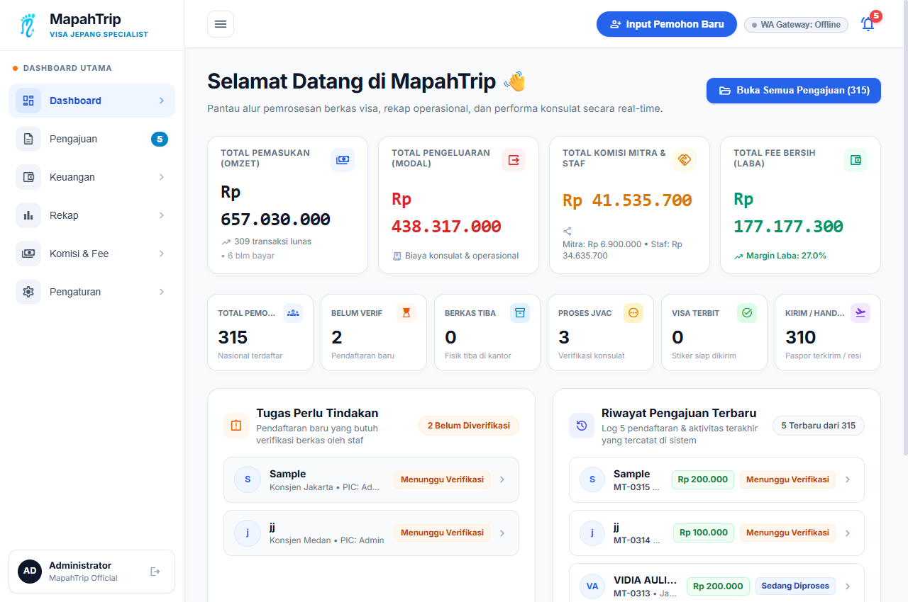

# 👑 Panduan Eksekutif Owner & Super Admin
**MapahTrip — Kendali Bisnis, Keuangan, & Otorisasi Operasional**

Buku panduan ini merupakan acuan operasional dan finansial resmi bagi Owner / Manajemen Puncak MapahTrip. Panduan ini mencakup pengelolaan arus kas (omset, modal loket konsulat, komisi mitra, fee staf, laba bersih), siklus penagihan invoice ke pemohon, otorisasi status pembayaran (buka kunci proses staf), pencairan komisi & fee, hingga konfigurasi master tarif dan alamat konsulat, disertai **penjelasan rinci setiap gambar tampilan (screenshot)**.

---

## 🏛️ 1. Otoritas & Peran Super Admin

Sebagai Super Admin, Anda memegang kendali penuh atas:
1. **Keuangan Realtime:** Memantau pendapatan kotor, beban pengeluaran loket JVAC/Kedutaan, kewajiban komisi rekanan, dan laba bersih perusahaan.
2. **Otorisasi Pembayaran (Billing Gateway):** Menjadi satu-satunya pihak yang berhak menyatakan bahwa pembayaran biaya visa telah **"Lunas"** ke rekening PT Tokyo Asia Connection.
3. **Pengendali Kunci Operasional:** Status *Lunas* dari Owner adalah kunci pengaman yang membuka izin Staf PIC untuk memproses berkas ke loket JVAC.
4. **Master Konfigurasi:** Mengatur tarif visa (harga modal vs harga jual), paket add-on (Premium & Waiver), kontak WhatsApp PIC, dan alamat kantor cabang.

---

## 📈 2. Bedah Tampilan Dashboard Eksekutif Keuangan

Berikut adalah tampilan utama Dashboard Finansial Owner:

### 🔍 Penjelasan Rinci Setiap Bagian pada Gambar Dashboard Owner:

#### 1. Lima (5) Pilar Metrik Finansial Utama:
- **Total Pemasukan (Omset): `Rp 218.400.000`**
  * Seluruh akumulasi dana yang ditagihkan dan dibayarkan oleh pemohon visa dari semua program.
- **Biaya Konsulat & JVAC: `Rp 140.700.000`**
  * Estimasi pengeluaran wajib yang harus disetorkan ke loket VFS Global / Konsulat Jenderal Jepang untuk penerbitan stiker visa resmi.
- **Total Komisi Mitra: `Rp 21.000.000`**
  * Akumulasi kewajiban komisi yang harus dibayarkan ke mitra affiliate (Rp 50.000 - Rp 150.000 per paspor binaan yang lunas).
- **Total Fee Staf PIC: `Rp 10.500.000`**
  * Akumulasi kewajiban fee operasional untuk staf lapangan PIC konsulat (Rp 50.000 per paspor selesai).
- **Laba Bersih MapahTrip: `Rp 46.200.000`**
  * Margin laba murni perusahaan setelah dikurangi seluruh biaya pihak ketiga:
    $$\text{Laba Bersih} = \text{Omset} - (\text{Biaya Konsulat} + \text{Komisi Mitra} + \text{Fee Staf})$$

#### 2. Distribusi Sebaran 5 Wilayah Konsulat:
- Menampilkan grafik / tabulasi pembagian volume pengajuan di seluruh yurisdiksi Indonesia:
  * **Konsjen Jakarta (KBRI):** 180 pemohon (volume terbesar).
  * **Konsjen Surabaya:** 15 pemohon.
  * **Konsjen Medan:** 5 pemohon.
  * **Konsjen Makassar:** 5 pemohon.
  * **Konsjen Bali / Denpasar:** 5 pemohon.
- Membantu manajemen mengevaluasi kinerja dan ketersediaan kapasitas staf PIC di tiap kantor cabang.

---

## 💳 3. Bedah Tampilan Menu Pengajuan & Prosedur Penagihan

Menu Pengajuan adalah tempat eksekusi penagihan invoice resmi dan validasi mutasi pembayaran:

### 🔍 Penjelasan Rinci Setiap Bagian pada Gambar Menu Pengajuan:

#### 1. Indikator Status & Filter Pencarian:
- **Pencarian Cepat:** Mencari data pemohon berdasarkan nama, nomor paspor, atau kode registrasi `MT-xxxx`.
- **Filter Status Pembayaran:** Memisahkan data *Lunas* vs *Belum Lunas*.

#### 2. Tombol Aksi Penagihan WhatsApp:
- Pada baris pemohon, terdapat tombol hijau **"Kirim Tagihan"**.
- Saat tombol ini diklik, sistem membuka percakapan WhatsApp ke nomor pemohon dengan pesan tagihan resmi terformat rapi yang memuat:
  * ID Pengajuan & Nama Pemohon.
  * Rincian Program Visa & Layanan Tambahan (Reguler / Premium).
  * Total Biaya Tagihan.
  * Rekening Resmi Pembayaran:
    > **BANK BTN**  
    > No. Rekening: **1401-50-008080-6**  
    > Atas Nama: **PT Tokyo Asia Connection**

#### 3. Kontrol Otorisasi Status Pembayaran:
- **Status "Belum Lunas":** Status awal saat berkas tiba. Pada kondisi ini, staf PIC di lapangan terkunci dan dilarang memproses berkas ke loket konsulat.
- **Mengubah Menjadi "Lunas":**
  * Setelah Owner memeriksa mutasi rekening Bank BTN dan memastikan dana masuk, Owner mengklik tombol status bayar pemohon dan memilih opsi **"Lunas"**.
  * **Efek Seketika:** Tombol status berubah menjadi hijau (*LUNAS - Siap JVAC*), dan sistem secara otomatis **membuka gembok tombol "Proses" pada portal Staf PIC**.

#### 4. Tombol Aksi Tambahan:
- **Rincian:** Melihat data formulir lengkap pemohon, foto KTP, dan paspor yang diunggah.
- **Tolak:** Membatalkan pengajuan yang bermasalah.
- **Hapus:** Menghapus data permohonan fiktif / uji coba agar laporan omset tetap akurat.

---

## ⚙️ 4. Bedah Tampilan Menu Pengaturan Master & Tarif

Menu Pengaturan digunakan untuk mengelola data operasional kantor dan struktur harga:

### 🔍 Penjelasan Rinci Setiap Bagian pada Gambar Pengaturan:

#### 1. Master Konsulat & Alamat Pengiriman PIC:
- Menampilkan daftar 5 perwakilan konsulat: Jakarta, Surabaya, Medan, Makassar, Denpasar.
- Pada masing-masing konsulat, Owner dapat memperbarui:
  * **Nama Staf PIC:** Petugas yang bertanggung jawab di wilayah tersebut.
  * **Nomor WhatsApp PIC:** Nomor telepon untuk menerima pemberitahuan berkas tiba.
  * **Alamat Lengkap Kantor Cabang:** Alamat tujuan yang akan diberikan kepada pemohon saat hendak mengirimkan paspor fisik melalui kurir/ekspedisi.

#### 2. Matrix Master Tarif Visa (Pricing Engine):
- Menentukan **Harga Modal Loket JVAC** vs **Harga Jual ke Pemohon** untuk setiap kategori visa:
  * Visa Turis Single Entry
  * Visa Turis Multiple Entry
  * Visa Kunjungan Keluarga / Teman
  * Visa Tokutei Ginou / Kerja
  * Visa Bisnis / Pelatihan
- **Pengaturan Add-on Tambahan:**
  * **Paket Premium Fast-Track / Prioritas (+Rp 600.000):** Opsi penanganan berkas ekspres prioritas.
  * **Japan e-Visa / Waiver (Rp 200.000 flat):** Biaya pengurusan waiver e-paspor tanpa penyerahan paspor fisik ke JVAC.

#### 3. Antrean WhatsApp Gateway (Outbox):
- Terletak pada navbar atas khusus tampilan Owner.
- Berfungsi untuk memonitor status pengiriman pesan otomatis ke pemohon, staf, dan owner, serta menyediakan tombol kirim ulang instan jika ada pesan yang sempat pending saat jaringan terputus.
