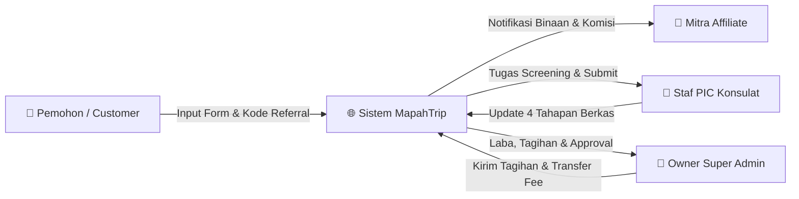

# 📘 BUKU PANDUAN RESMI & SOP OPERASIONAL MAPAHTRIP.ID
*Sistem Informasi Manajemen Pengurusan Visa Jepang Terintegrasi*

---

## 🌐 Pendahuluan: Ekosistem 3 Aktor MapahTrip

Sistem **MapahTrip** dirancang dengan arsitektur 3 pilar yang saling terhubung secara *real-time* via Supabase Cloud Database:
1. **Mitra Affiliate (Partner):** Pihak mitra/rekanan yang mereferensikan pemohon visa dengan kode referral resmi, memantau berkas binaan, dan menerima komisi pencairan.
2. **Staf PIC Konsulat (Operasional):** Tim petugas lapangan di 5 konsulat resmi (Jakarta, Surabaya, Medan, Makassar, Denpasar) yang menerima berkas fisik, screening dokumen, mengurus ke loket JVAC/Kedutaan, dan mengirimkan paspor.
3. **Owner MapahTrip (Super Admin):** Pengelola utama yang memantau arus kas, laba bersih, invoice tagihan pemohon, transfer komisi/fee staf, pengaturan master tarif, dan automasi WhatsApp Gateway.

---

## BAB I: Panduan Lengkap Mitra Affiliate (Partner Portal)

### 1.1. Cara Mengakses & Login Portal Mitra
- **Link Akses:** Buka website `mapahtrip.id/#affiliate` (atau klik menu **Portal Mitra** di bagian footer).
- **Identitas Mitra:** Masuk menggunakan ID Akun / Email yang terdaftar dan PIN/Kata Sandi resmi.

### 1.2. Tampilan Dashboard Mitra

### 1.3. Penjelasan Fitur & Menu Mitra:
1. **Kotak Kode Referral Unik (Pojok Kiri Atas):**
   - Menampilkan kode resmi mitra (Contoh: `MPH965RE`).
   - Tombol **"Salin Kode"**: Klik untuk langsung menyalin kode ke clipboard, atau membagikan link pendaftaran langsung ke calon pemohon.
2. **Kartu Statistik Kinerja (Stat Cards):**
   - **Total Pemohon:** Jumlah seluruh kandidat/pemohon yang mendaftar menggunakan kode referral Anda.
   - **Berkas Lengkap:** Jumlah pemohon yang seluruh formulir & paspornya sudah terverifikasi valid.
   - **Proses JVAC:** Pemohon yang berkasnya sedang diproses di loket resmi Konsulat/JVAC.
   - **Visa Terbit:** Paspor yang sudah berhasil mendapatkan stiker/approval visa Jepang.
3. **Dompet Komisi & Saldo Insentif:**
   - Menampilkan akumulasi komisi yang terkumpul dari pemohon yang telah lunas.
   - Komisi resmi: **Rp 50.000 – Rp 150.000** per paspor yang disetujui.
   - Tombol **"Tarik Komisi / Riwayat Payout"**: Memantau riwayat transfer dana komisi dari Owner ke rekening bank mitra terdaftar.
4. **Tabel Kandidat Binaan:**
   - Menampilkan nama pemohon, jenis program visa (Waiver, Tokutei Ginou, Single, Multiple, dll), tanggal masuk, serta status tahapan dokumen saat ini secara transparan.

> [!TIP]
> **Tips untuk Mitra:** Pastikan calon pemohon memilih opsi *"Ya, Punya Kode"* dan memasukkan kode Anda saat mengisi formulir di website Mapahtrip agar pendaftaran otomatis tercatat ke dashboard Anda.

---

## BAB II: Panduan Lengkap Staf PIC Konsulat (Operasional)

### 2.1. Cara Mengakses & Login Akun Staf
- **Link Akses:** Buka `mapahtrip.id/#staff`
- **Pilihan Profil:** Pilih nama staf operasional (Rizky - Jakarta, Nanami - Surabaya, Heru - Medan, Latifah - Makassar, Yulia - Denpasar) dan masukkan 4-digit PIN keamanan Anda.

### 2.2. Tampilan Workspace Staf PIC

### 2.3. SOP 4 Tahapan Pemrosesan Berkas Konsulat:
Setiap baris pemohon memiliki 4 tombol tahapan berurutan (*Sequential Stages*):

| Tahap | Nama Tahap | Tindakan Staf PIC | Aturan Sistem |
| :---: | :--- | :--- | :--- |
| **1** | **SAMPAI** | Klik saat paket kurir ekspedisi / paspor fisik pemohon tiba di alamat staf. | Mengaktifkan tanggal tiba berkas dan memberi notifikasi ke Owner bahwa berkas siap diverifikasi & ditagih. |
| **2** | **PROSES** | Klik saat staf berangkat dan mensubmit dokumen fisik ke loket Konsulat Jenderal / JVAC VFS. | **FITUR PENGUNCI:** Jika status pembayaran pemohon *Belum Lunas*, tombol ini **TERKUNCI** untuk staf. Staf dilarang submit berkas sebelum mendapat persetujuan pelunasan dari Owner. |
| **3** | **SELESAI** | Klik saat paspor telah selesai diproses oleh konsulat dan visa Jepang berhasil ditempel (*Issued*). | Mencatat tanggal selesai dan memicu penghitungan fee staf PIC. |
| **4** | **KIRIM** | Klik saat paspor dikirim balik ke pemohon via kurir (JNE/J&T/TIKI) atau diserahterimakan langsung di Bandara Soetta Terminal 3. | Staf wajib memasukkan **Nomor Resi Pengiriman** atau jadwal flight serah terima bandara. |

### 2.4. Keuangan & Tracking Fee Staf:
- Setiap paspor yang berhasil ditangani menghasilkan hak **Fee Staf PIC sebesar Rp 50.000 / paspor**.
- Staf dapat melihat status payout fee di menu sidebar **"Fee Staf PIC"** apakah sudah ditransfer oleh Owner beserta bukti struk transfernya.

> [!IMPORTANT]
> **SOP Privasi & Alamat PIC:** Jangan membagikan alamat pribadi staf di forum terbuka. Seluruh komunikasi pengiriman paspor dipandu secara personal oleh Customer Service resmi MapahTrip.

---

## BAB III: Panduan Lengkap Owner MapahTrip (Super Admin)

Owner memiliki hak akses tertinggi untuk mengendalikan seluruh operasional, keuangan, dan pengaturan harga.

### 3.1. Dashboard Eksekutif Keuangan & Monitoring Wilayah
- **Link Akses:** Buka `mapahtrip.id/#owner` lalu masukkan PIN Master Admin.

**Informasi Utama di Dashboard:**
1. **Ringkasan Finansial Real-Time:**
   - **Total Pemasukan (Omset):** Total dana jasa yang dibayarkan oleh pemohon.
   - **Total Pengeluaran (Modal Loket/Biaya Resmi):** Biaya stiker visa kedutaan/JVAC.
   - **Komisi Mitra & Fee Staf:** Total hak rekanan yang harus dibayarkan.
   - **Laba Bersih MapahTrip:** Keuntungan riil bersih perusahaan setelah dipotong seluruh beban.
2. **Monitoring 5 Wilayah Konsulat:**
   - Pemantauan volume berkas aktif di Konsulat Jakarta, Surabaya, Medan, Makassar, dan Bali secara berdampingan.

---

### 3.2. Manajemen Daftar Pengajuan & Penagihan (Billing)

**Alur Kerja Penagihan & Approval Berkas:**
1. **Pemohon Mendaftar:** Data masuk dengan status awal *Menunggu Verifikasi* dan *Belum Lunas*.
2. **Berkas Tiba di Staf (Status: Sampai):** Begitu staf PIC mengklik *Sampai*, Owner menerima notifikasi di dashboard bahwa berkas fisik pemohon sudah aman di tangan staf.
3. **Kirim Tagihan Resmi:** Owner mengklik tombol **"Kirim Tagihan"**. Sistem secara otomatis menyiapkan pesan WhatsApp resmi berisi invoice rincian biaya dan nomor rekening transfer resmi (Bank BTN a.n PT Tokyo Asia Connection).
4. **Konfirmasi Pembayaran:**
   - Klik tombol status bayar untuk mengubah menjadi **`Lunas`**.
   - Begitu berstatus *Lunas*, gembok pada akun Staf PIC otomatis terbuka, sehingga staf dapat langsung mensubmit berkas ke Konsulat/JVAC.
5. **Tombol Rincian:** Klik untuk melihat seluruh histori berkas, pasfoto, kelengkapan 7 dokumen persyaratan, serta log waktu tiap tahap.

---

### 3.3. Pengaturan Master Konsjen, Staf & Tarif Visa

1. **Pengaturan Tarif Visa (Pricing Matrix):**
   - Owner dapat mengatur tarif resmi per konsulat (Jakarta, Surabaya, Medan, Makassar, Denpasar).
   - Tampilan kartu landing page secara otomatis menghitung rentang dari tarif konsulat terendah s/d tertinggi.
   - Kolom **Paket Premium (+Rp 600.000)** dapat diatur tanpa khawatir membuat harga kartu depan terlihat mahal.
   - Untuk **Japan e-Visa / Waiver**, harga berlaku Flat Rp 200.000 untuk seluruh wilayah Indonesia.
2. **Kelola Staf & Master Konsjen:**
   - Mengubah nomor WhatsApp PIC, alamat penerima berkas fisik, dan persentase fee staf.
   - Reset PIN login staf jika lupa sandi.
3. **Automasi WhatsApp Gateway:**
   - Indikator status gateway (Online / Offline) dan monitoring antrean outbox pesan notifikasi pendaftar baru.

---

## BAB IV: Ringkasan Alur Pendaftaran Pemohon (Customer Journey)

1. **Pemilihan Program Visa:** Pemohon memilih kategori visa pada katalog landing page (`Mulai dari Rp 200rb` s/d paket multipel).
2. **Cek Syarat & Input Kode Referral:** Pemohon memeriksa estimasi durasi proses (JAVES 2-3 hari kerja / Konsulat 6 hari kerja) dan memasukkan kode referral mitra jika memiliki rekomendasi.
3. **Isi Formulir Singkat:** Mengisi identitas, konsulat tujuan, dan memilih paket layanan (*Reguler* vs *Premium Prioritas*).
4. **Konfirmasi via WhatsApp:** Setelah menekan submit, pemohon menerima ID Pendaftaran (misal: `MT-0313`) dan diarahkan langsung ke WhatsApp resmi MapahTrip `+62 814-0173-5648` untuk panduan pengiriman berkas fisik ke PIC.

---

## 📞 Kontak Dukungan & Layanan Teknis

- **Pusat Bantuan & WhatsApp Admin:** [+62 814-0173-5648](https://wa.me/6281401735648)
- **Website Resmi:** [https://mapahtrip.id](https://mapahtrip.id)
- **Dokumentasi Internal:** Tersimpan dan tersinkronisasi di MapahTrip Enterprise Cloud Database.
