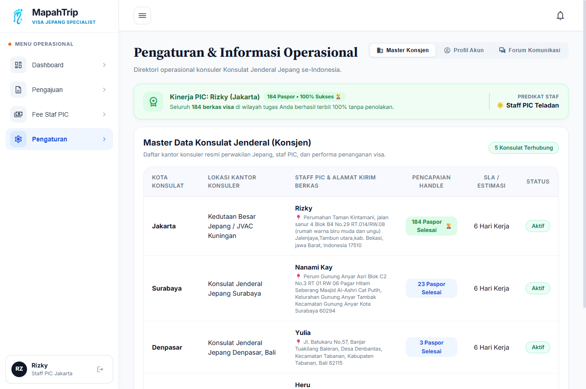

# 🛠️ Panduan Standar Operasional Prosedur (SOP) Staf PIC Konsulat
**MapahTrip — Spesialis Jasa Pengurusan Visa Jepang**

Buku panduan ini merupakan pegangan wajib bagi seluruh Staf PIC Operasional di wilayah Konsulat Jenderal Jepang (Jakarta, Surabaya, Medan, Makassar, dan Denpasar). Panduan ini merinci setiap alur kerja dari saat berkas fisik tiba di kantor, koordinasi penagihan pembayaran dengan Owner, penguncian sistem demi keamanan modal, pengajuan ke JVAC, hingga pengiriman paspor kembali ke pemohon.

---

## 🏢 1. Peran & Tanggung Jawab Staf PIC

Sebagai ujung tombak operasional MapahTrip, Staf PIC bertanggung jawab untuk:
1. Menerima, memeriksa kelengkapan, dan menjaga keamanan dokumen fisik (paspor asli, KTP, KK, rekening koran, surat sponsor, CoE, dll).
2. Memperbarui status berkas secara disiplin pada sistem portal MapahTrip.
3. Menyerahkan berkas ke loket resmi JVAC (VFS Global) atau Kedutaan / Konsulat Jenderal Jepang sesuai domisili yurisdiksi.
4. Mengambil paspor yang telah tertempel visa dan mengirimkannya kembali dengan aman ke pemohon.
5. **Fee Operasional:** Setiap paspor yang berhasil diselesaikan memberikan hak fee operasional sebesar **Rp 50.000 / paspor** bagi Staf PIC.

---

## 🔐 2. Akses & Login Portal Staf

1. Kunjungi portal operasional: `https://mapahtrip.id/#staff`.
2. Masukkan **4-Digit PIN Rahasia Staf** sesuai akun wilayah tugas Anda (misal: PIC Jakarta Rizki/Ulla, PIC Surabaya, PIC Medan, dll).
3. Klik tombol **"Masuk ke Portal Staf ➔"**.


*(Tampilan Meja Kerja Daftar Pengajuan Staf PIC Jakarta)*

---

## 📑 3. Penjelasan Menu di Portal Staf

Di panel navigasi sebelah kiri, terdapat 4 menu utama:

1. **Dashboard:**
   - Menampilkan rangkuman beban kerja staf per hari ini:
     * *Total Pemohon:* Jumlah antrean paspor yang dialokasikan ke wilayah konsulat Anda.
     * *Belum Verif:* Data pendaftar baru yang belum mengirimkan berkas fisik.
     * *Berkas Tiba:* Berkas yang sudah sampai di meja staf dan sedang menunggu pelunasan invoice oleh Owner.
     * *Proses JVAC:* Berkas yang saat ini sedang berada di loket pemeriksaan konsulat.
     * *Selesai / Terbit:* Paspor yang visanya telah disetujui.

2. **Pengajuan (Meja Kerja Utama):**
   - Menampilkan tabel seluruh pemohon lengkap dengan nama, nomor paspor, program visa, indikator checklist dokumen, tombol 4 tahapan berkas (`Sampai`, `Proses`, `Selesai`, `Kirim`), status bayar, serta tombol `Rincian`, `Tolak`, dan `Hapus`.

3. **Fee Staf PIC:**
   - Rekapitulasi perolehan hak fee staf (Rp 50.000 / paspor).
   - Menampilkan status pencairan fee (`Menunggu Transfer Owner` atau `Sudah Lunas Ditransfer`).

4. **Pengaturan:**
   - Memuat informasi identitas staf, nomor WhatsApp operasional, dan alamat kantor penerimaan berkas paspor.

---

## 🔄 4. Alur Standar Operasional Berkas (End-to-End)

```
[Pemohon Kirim Paspor Fisik]
              │
              ▼
[1. Berkas Tiba di Meja Staf] ──► Staf Klik: [✓ Sampai]
                                         │
                                         ▼ (Notifikasi Otomatis ke Owner)
[2. Owner Tagih & Validasi Dana] ──► Owner Mengubah: [Status Bayar: LUNAS]
                                         │
                                         ▼ (Gembok Tombol Terbuka)
[3. Submit ke Loket Konsulat] ──► Staf Klik: [✓ Proses]
              │
              ▼
[4. Pengambilan Paspor Ber-Visa] ──► Staf Klik: [✓ Selesai]
              │
              ▼
[5. Pengiriman Paspor ke Pemohon] ──► Staf Klik: [✓ Kirim] (Input Resi / T3 Soetta)
```

---

### 📍 Langkah 1: Berkas Fisik Tiba di Kantor ➔ Klik "Sampai"
1. Paket paspor fisik pemohon tiba di kantor PIC melalui kurir (JNE, J&T, SiCepat, Grab, Gojek, atau ekspedisi lainnya).
2. Buka paket dengan hati-hati. Cocokkan dokumen fisik dengan checklist persyaratan (paspor asli, pasfoto latar putih 4.5x3.5 cm, fotokopi identitas, dokumen pendukung).
3. Cari nama pemohon pada tabel **Pengajuan**.
4. Klik tombol **"✓ Sampai"**.
5. Tanggal berkas tiba otomatis tercatat di sistem (misal: `2026-11-28`).

> 📢 **Otomatisasi Sistem ke Owner:**
> Begitu Anda mengklik tombol **"Sampai"**, sistem WA Gateway otomatis mengirim pesan notifikasi ke WhatsApp Owner:
> *"BERKAS SAMPAI (SIAP DITAGIH) — Berkas fisik MT-xxxx telah tiba di kantor PIC. Siap kirim tagihan di Dashboard Owner: https://mapahtrip.id/#owner"*

---

### 🛡️ Langkah 2: PROTEKSI PENTING — Tombol "Proses" Terkunci!

> [!CAUTION]
> **ATURAN MUTLAK MANAJEMEN:**
> Staf PIC **DILARANG KERAS** membawa atau mendaftarkan berkas pemohon ke loket JVAC / Kedutaan Jepang sebelum Owner memverifikasi pembayaran!

- Mengapa? Setiap penyerahan berkas ke loket JVAC membutuhkan pembayaran biaya visa secara tunai/debit di muka menggunakan modal kas perusahaan. Jika berkas diproses sebelum pemohon membayar, MapahTrip berisiko mengalami kerugian fatal bila pemohon membatalkan sepihak.
- **Sistem Gembok Otomatis:**
  * Tombol **"✓ Proses"** akan menampilkan peringatan dan terkunci selama status pembayaran pemohon masih berstatus **"Belum Lunas"**.
  * Tunggu hingga Owner menerima transfer dari pemohon dan mengubah status bayar menjadi **"LUNAS (Siap JVAC)"**.
  * Begitu status berwarna hijau (*LUNAS*), kunci tombol *Proses* akan otomatis terbuka.

---

### 🏛️ Langkah 3: Berkas Diserahkan ke JVAC / Konsulat ➔ Klik "Proses"
1. Setelah status pembayaran pemohon terverifikasi **LUNAS**, bawa berkas ke loket resmi:
   - **Jakarta:** JVAC VFS Global Kuningan City Mall Lt. 2 / Kedutaan Besar Jepang.
   - **Surabaya, Medan, Makassar, Denpasar:** Kantor Konsulat Jenderal Jepang setempat.
2. Dapatkan nomor referensi loket / invoice resmi JVAC.
3. Buka portal staf, lalu klik tombol **"✓ Proses"**.
4. Status pelacakan pemohon di website utama otomatis terupdate menjadi *"Sedang diverifikasi pihak konsulat"*.

---

### 🏷️ Langkah 4: Visa Selesai / Terbit ➔ Klik "Selesai"
1. Pantau status approval dari loket JVAC / Kedutaan (biasanya 4 - 7 hari kerja untuk visa reguler, atau 1 - 2 hari untuk e-Visa).
2. Setelah ada notifikasi paspor dapat diambil, Staf PIC mengambil paspor fisik di loket.
3. Periksa stiker visa: pastikan ejaan nama, nomor paspor, dan masa berlaku visa sudah sesuai 100%.
4. Pada portal staf, klik tombol **"✓ Selesai"**.
5. Sistem mencatat bahwa tugas pengurusan visa oleh staf telah berhasil.

---

### 📦 Langkah 5: Pengembalian Paspor ke Pemohon ➔ Klik "Kirim"
1. Kemas paspor dengan amplop tebal dan bubble wrap pelindung anti air.
2. Lakukan pengiriman sesuai preferensi pemohon:
   - **Via Kurir Ekspedisi:** Kirim melalui JNE YES / Paxel / Pos Indonesia, lalu simpan nomor resi pengiriman.
   - **Handover Langsung (Bandara Soekarno-Hatta T3):** Untuk pemohon luar kota yang langsung transit penerbangan ke Jepang, koordinasikan jadwal serah terima di meeting point Terminal 3.
3. Di portal staf, klik tombol **"✓ Kirim"**.
4. Masukkan **Nomor Resi Pengiriman** atau **Keterangan Penyerahan Langsung** pada jendela konfirmasi.
5. Pemohon akan menerima notifikasi bahwa paspor mereka telah dalam perjalanan kembali beserta tautan pelacakan nomor resinya.

---

## 💵 5. Pencatatan & Pembayaran Fee Staf PIC

- Setiap berkas yang telah melewati tahap pengurusan akan secara otomatis menambahkan saldo hak fee Anda sebesar **Rp 50.000 / paspor**.
- Anda dapat memantau akumulasi total fee pada menu **"Fee Staf PIC"**.
- Tim Finance / Owner akan mentransfer total fee operasional secara berkala ke rekening bank staf yang terdaftar.
